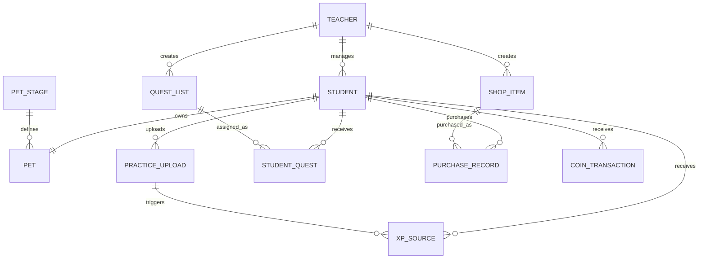
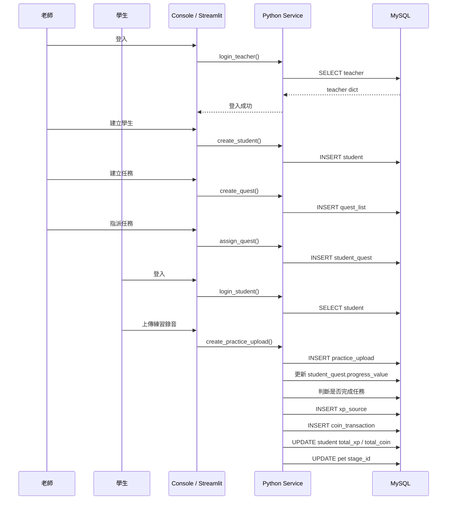

# 00_Melody Quest 音樂練習 RPG 系統（上下文資訊文件）

> 本文件用於提供 AI 專案的固定上下文，包含專案目標、技術限制、資料庫結構、目錄架構、已完成進度與開發規則。後續使用 AI 協助開發時，應先提供或更新本文件，避免 AI 任意修改架構、欄位名稱與既有功能。

---

## 0. 一句話解釋專案目的

> 本專案是一套提供一對一音樂老師管理學生練習的 RPG 遊戲化系統；老師可建立學生、設計與指派任務，學生透過上傳練習錄音累積任務進度、XP 與金幣，並讓寵物進化或兌換老師建立的獎勵商品。

---

# 1. 專案全局認知與技術堆疊

## 1.1 專案名稱

**Melody Quest：音樂練習 RPG 系統**

資料庫名稱：

```text
music_rpg_v2
```

## 1.2 專案目標

本專案希望解決以下問題：

1. 學生在課後缺乏持續練習的動機。
2. 老師難以確認學生是否有規律練習。
3. 傳統練習紀錄缺乏即時回饋與獎勵。
4. 老師需要一套簡單工具管理學生、任務與練習紀錄。

系統透過以下遊戲化機制提高學生參與度：

```text
練習錄音
→ 任務進度
→ XP 與金幣
→ 寵物進化
→ 商城兌換
```

## 1.3 目標使用者

### 老師

- 註冊與登入
- 建立學生帳號
- 查看學生列表
- 重設學生密碼
- 修改自己的密碼
- 建立、查看、修改與停用任務
- 指派任務給學生
- 查看學生練習紀錄
- 建立與管理商城商品

### 學生

- 使用老師提供的帳號登入
- 修改初始密碼
- 查看被指派的任務
- 上傳練習錄音
- 查看任務進度
- 查看 XP、金幣與寵物狀態
- 使用金幣兌換老師建立的商品

## 1.4 核心假設

> 透過任務、XP、金幣、寵物進化與獎勵兌換等遊戲化機制，可以提高學生持續練習的意願，並讓老師更有效率地掌握學生的練習狀況。

## 1.5 技術堆疊

### 程式語言

```text
Python 3.12
```

### 前端

```text
Streamlit
HTML
CSS
```

目前先以 Console 版本建立並測試完整流程，再將輸入與輸出介面改寫為 Streamlit。

### 後端

```text
Python
```

目前不使用：

- Django
- Node.js
- Go
- Java Spring
- React
- Vue

MVP 階段暫不建立 RESTful API，主要由 Streamlit 直接呼叫 Python Service functions。

### 資料庫

```text
MySQL
```

### 資料庫連線

```text
PyMySQL
```

### 密碼安全

```text
bcrypt
```

不得將老師或學生的原始密碼存入資料庫。

### 版本控制

```text
Git
GitHub
```

### 套件管理

```text
Python venv
requirements.txt
```

### 未來可加入但不屬於目前 MVP

- Linux 部署
- Docker
- Docker Compose
- 爬蟲
- 雲端物件儲存
- RESTful API
- 自動排程
- AI 演奏分析

---

# 2. MVP 定義

## 2.1 MVP 核心閉環

```text
老師建立學生
→ 老師建立並指派任務
→ 學生登入
→ 學生上傳練習錄音
→ 系統更新任務進度
→ 任務完成
→ 系統發放 XP 與金幣
→ 寵物進化或兌換商品
```

## 2.2 MVP 必要功能

### 帳號系統

- 老師註冊
- 老師登入
- 學生登入
- 老師建立學生帳號
- 老師重設學生密碼
- 老師修改自己的密碼
- 學生修改初始密碼

### 任務系統

- 老師查看任務
- 老師建立任務
- 老師修改任務
- 老師啟用或停用任務
- 老師指派任務給學生
- 學生查看被指派的任務
- 系統更新任務進度
- 系統判斷任務是否完成
- 任務過期後不再列為進行中

### 練習系統

- 學生輸入曲目名稱
- 學生上傳或錄製音檔
- 紀錄錄音秒數
- 建立練習上傳紀錄
- 老師查看學生練習紀錄

### RPG 系統

- 任務完成後發放 XP
- 任務完成後發放金幣
- 累積 XP
- 累積金幣
- 根據 XP 更新寵物階段

### 商城系統

- 老師建立商品
- 老師查看、修改、停用商品
- 學生查看老師建立的商品
- 學生使用金幣購買或兌換商品
- 保留購買紀錄

## 2.3 MVP 不包含功能

1. AI 自動評分演奏品質
2. 音高辨識
3. 節奏辨識
4. 即時音訊分析
5. LINE Bot
6. 排行榜
7. 好友或社群系統
8. 推播通知
9. 行事曆同步
10. 多位老師共同管理同一學生
11. 手機 App
12. 雲端物件儲存
13. 定期爬取演出資訊
14. 自動排程清除錄音
15. RESTful API
16. Docker 容器化
17. 正式商業部署

## 2.4 MVP 驗收標準

1. 老師可成功註冊並登入。
2. 老師可建立至少一位學生。
3. 學生可使用系統產生的帳號與臨時密碼登入。
4. 老師可建立至少一項任務。
5. 老師可將任務指派給學生。
6. 學生可查看自己的進行中任務。
7. 學生可建立至少一筆練習錄音紀錄。
8. 練習紀錄可更新任務進度。
9. 任務完成後可發放 XP 與金幣。
10. 學生總 XP 與總金幣可正確更新。
11. 寵物可依 XP 門檻更新階段。
12. 學生可查看並兌換老師建立的商品。
13. 老師只能查看自己建立的學生、任務與商品。
14. 查無資料時需顯示提示文字，不得直接發生程式錯誤。
15. 密碼不得以明文形式儲存於資料庫。

---

# 3. 資料庫綱要與資料結構

資料庫：

```text
MySQL
Database：music_rpg_v2
Character Set：utf8mb4
Collation：utf8mb4_unicode_ci
```

## 3.1 `teacher`

每一列代表一位老師帳號。

| 欄位 | 型態 | 限制 | 說明 |
|---|---|---|---|
| `teacher_id` | INT | PK、AUTO_INCREMENT | 老師唯一編號 |
| `teacher_name` | VARCHAR(50) | NOT NULL | 老師姓名 |
| `email` | VARCHAR(100) | NOT NULL、UNIQUE | 登入帳號 |
| `password_hash` | VARCHAR(255) | NOT NULL | bcrypt 密碼雜湊 |
| `created_at` | TIMESTAMP | DEFAULT CURRENT_TIMESTAMP | 建立時間 |

## 3.2 `student`

每一列代表一位學生帳號。

| 欄位 | 型態 | 限制 | 說明 |
|---|---|---|---|
| `student_id` | INT | PK、AUTO_INCREMENT | 學生唯一編號 |
| `teacher_id` | INT | FK、NOT NULL | 所屬老師 |
| `username` | VARCHAR(50) | NOT NULL、UNIQUE | 系統產生的學生帳號 |
| `password_hash` | VARCHAR(255) | NOT NULL | 學生密碼雜湊 |
| `student_name` | VARCHAR(50) | NOT NULL | 學生姓名 |
| `password_changed` | BOOLEAN | DEFAULT FALSE | 是否修改過臨時密碼 |
| `total_xp` | INT UNSIGNED | DEFAULT 0 | 學生累積 XP |
| `total_coin` | INT UNSIGNED | DEFAULT 0 | 學生目前金幣 |
| `created_at` | TIMESTAMP | DEFAULT CURRENT_TIMESTAMP | 建立時間 |

## 3.3 `pet_stage`

每一列代表一個寵物進化階段。

| 欄位 | 型態 | 限制 | 說明 |
|---|---|---|---|
| `stage_id` | INT | PK、AUTO_INCREMENT | 階段編號 |
| `stage_name` | VARCHAR(50) | NOT NULL | 階段名稱 |
| `xp_threshold` | INT | NOT NULL | 進化所需累積 XP |
| `image_url` | VARCHAR(255) | NULL | 寵物圖片路徑 |
| `stage_order` | INT | NOT NULL | 階段順序 |

預設階段：

```text
蛋：0 XP
幼體：100 XP
成體：500 XP
稀有型態：1500 XP
```

## 3.4 `pet`

每一列代表一位學生目前擁有的寵物。

| 欄位 | 型態 | 限制 | 說明 |
|---|---|---|---|
| `pet_id` | INT | PK、AUTO_INCREMENT | 寵物編號 |
| `student_id` | INT | FK、NOT NULL、UNIQUE | 所屬學生 |
| `stage_id` | INT | FK、NOT NULL | 目前進化階段 |
| `updated_at` | TIMESTAMP | 自動更新 | 最近更新時間 |

## 3.5 `practice_upload`

每一列代表一筆學生練習錄音紀錄。

| 欄位 | 型態 | 限制 | 說明 |
|---|---|---|---|
| `upload_id` | INT | PK、AUTO_INCREMENT | 上傳紀錄編號 |
| `student_id` | INT | FK、NOT NULL | 上傳學生 |
| `audio_url` | VARCHAR(255) | NOT NULL | 音檔儲存路徑 |
| `song_name` | VARCHAR(255) | NOT NULL | 練習曲目 |
| `audio_duration` | INT UNSIGNED | NOT NULL | 錄音秒數 |
| `created_at` | TIMESTAMP | DEFAULT CURRENT_TIMESTAMP | 上傳時間 |

索引：

```sql
INDEX idx_student_created (student_id, created_at)
```

## 3.6 `quest_list`

每一列代表一個老師建立的任務模板。

| 欄位 | 型態 | 限制 | 說明 |
|---|---|---|---|
| `quest_id` | INT | PK、AUTO_INCREMENT | 任務編號 |
| `teacher_id` | INT | FK、NOT NULL | 建立任務的老師 |
| `quest_name` | VARCHAR(100) | NOT NULL | 任務名稱 |
| `quest_type` | ENUM | NOT NULL | 任務類型 |
| `condition_type` | ENUM | NOT NULL | 任務條件 |
| `condition_value` | INT | NOT NULL | 完成條件數值 |
| `reward_xp` | INT | DEFAULT 0 | 任務 XP 獎勵 |
| `reward_coin` | INT | DEFAULT 0 | 任務金幣獎勵 |
| `is_repeatable` | BOOLEAN | DEFAULT TRUE | 是否可重複指派 |
| `is_active` | BOOLEAN | DEFAULT TRUE | 是否啟用 |
| `created_at` | TIMESTAMP | DEFAULT CURRENT_TIMESTAMP | 建立時間 |

`quest_type`：

```text
DAILY
WEEKLY
HIDDEN
```

`condition_type`：

```text
PRACTICE_COUNT
PRACTICE_DAYS
DISTINCT_SONGS
CONSECUTIVE_DAYS
TOTAL_UPLOADS
RETURN_AFTER_GAP
```

## 3.7 `student_quest`

每一列代表某位學生在特定期間被指派的一次任務。

| 欄位 | 型態 | 限制 | 說明 |
|---|---|---|---|
| `student_quest_id` | INT | PK、AUTO_INCREMENT | 學生任務紀錄編號 |
| `student_id` | INT | FK、NOT NULL | 被指派學生 |
| `quest_id` | INT | FK、NOT NULL | 任務模板 |
| `assigned_at` | DATETIME | DEFAULT CURRENT_TIMESTAMP | 指派時間 |
| `expires_at` | DATETIME | NULL | 任務截止時間 |
| `period_key` | VARCHAR | NOT NULL | 任務期間識別值 |
| `progress_value` | INT | DEFAULT 0 | 目前進度 |
| `completed` | BOOLEAN | DEFAULT FALSE | 是否完成 |
| `completed_at` | TIMESTAMP | NULL | 完成時間 |
| `created_at` | TIMESTAMP | DEFAULT CURRENT_TIMESTAMP | 紀錄建立時間 |

唯一限制：

```sql
UNIQUE KEY uk_student_quest_period (
    student_id,
    quest_id,
    period_key
)
```

任務狀態：

```text
completed = TRUE
→ 已完成

completed = FALSE 且 expires_at > NOW()
→ 進行中

completed = FALSE 且 expires_at <= NOW()
→ 已過期
```

## 3.8 `shop_item`

每一列代表老師建立的一項商品。

| 欄位 | 型態 | 限制 | 說明 |
|---|---|---|---|
| `item_id` | INT | PK、AUTO_INCREMENT | 商品編號 |
| `teacher_id` | INT | FK、NOT NULL | 建立商品的老師 |
| `item_name` | VARCHAR(100) | NOT NULL | 商品名稱 |
| `item_type` | ENUM | NOT NULL | 商品類型 |
| `price` | INT UNSIGNED | NOT NULL | 金幣價格 |
| `stock` | INT UNSIGNED | NULL | 庫存 |
| `description` | VARCHAR(255) | NULL | 商品說明 |
| `image_url` | VARCHAR(255) | NULL | 商品圖片路徑 |
| `is_active` | BOOLEAN | DEFAULT TRUE | 是否上架 |
| `created_at` | TIMESTAMP | DEFAULT CURRENT_TIMESTAMP | 建立時間 |

商品類型：

```text
VIRTUAL
PHYSICAL
```

## 3.9 `purchase_record`

每一列代表一筆商品購買或兌換紀錄。

| 欄位 | 型態 | 限制 | 說明 |
|---|---|---|---|
| `purchase_id` | INT | PK、AUTO_INCREMENT | 購買紀錄編號 |
| `student_id` | INT | FK、NOT NULL | 購買學生 |
| `item_id` | INT | FK、NOT NULL | 商品 |
| `price` | INT UNSIGNED | NOT NULL | 購買當下價格 |
| `status` | ENUM | DEFAULT OWNED | 購買狀態 |
| `created_at` | TIMESTAMP | DEFAULT CURRENT_TIMESTAMP | 購買時間 |

狀態：

```text
OWNED
PURCHASED
REDEEMED
```

## 3.10 `xp_source`

每一列代表一次學生 XP 異動紀錄。

| 欄位 | 型態 | 限制 | 說明 |
|---|---|---|---|
| `xp_source_id` | INT | PK、AUTO_INCREMENT | XP 異動編號 |
| `student_id` | INT | FK、NOT NULL | 學生 |
| `upload_id` | INT | FK、NULL | 相關練習紀錄 |
| `xp_amount` | INT | NOT NULL | XP 異動量 |
| `source_type` | ENUM | NOT NULL | XP 來源 |
| `created_at` | TIMESTAMP | DEFAULT CURRENT_TIMESTAMP | 建立時間 |

來源：

```text
PRACTICE_UPLOAD
QUEST_REWARD
HIDDEN_QUEST
TEACHER_ADJUST
```

## 3.11 `coin_transaction`

每一列代表一次金幣增加或扣除紀錄。

| 欄位 | 型態 | 限制 | 說明 |
|---|---|---|---|
| `coin_transaction_id` | INT | PK、AUTO_INCREMENT | 金幣異動編號 |
| `student_id` | INT | FK、NOT NULL | 學生 |
| `source_type` | ENUM | NOT NULL | 金幣來源 |
| `amount` | INT | NOT NULL | 正數增加、負數扣除 |
| `created_at` | TIMESTAMP | DEFAULT CURRENT_TIMESTAMP | 建立時間 |

來源：

```text
PRACTICE_UPLOAD
QUEST_REWARD
HIDDEN_QUEST
SHOP_PURCHASE
TEACHER_ADJUST
```

---

# 4. 資料表關聯



---

# 5. 專案目錄結構與架構模式

```text
NoteVenture/
├── main.py
├── app.py
├── db.py
├── config.ini
├── requirements.txt
├── .gitignore
│
├── services/
│   ├── teacher_service.py
│   ├── student_service.py
│   ├── quest_service.py
│   ├── practice_service.py
│   ├── reward_service.py
│   ├── pet_service.py
│   ├── shop_service.py
│   └── dashboard_service.py
│
├── utils/
│   ├── __init__.py
│   ├── password_utils.py
│   └── username_utils.py
│
├── sql/
│   └── music_rpg_schema_v2.sql
│
├── uploads/
│   └── audio/
│
├── teacher_menu.py
├── student_menu.py
├── reset_teacher_password.py
├── test_password.py
└── test.ipynb
```

## 5.1 各檔案職責

### `main.py`

Console 版本入口，負責顯示角色選單、登入流程與進入老師或學生選單。

### `app.py`

Streamlit 網頁入口。

### `db.py`

負責讀取 `config.ini`、建立連線、`query_one()`、`query_all()`、`execute()`、commit、rollback 與 close。

### `teacher_menu.py`

負責老師 Console 選單流程，不應放大量 SQL。

### `student_menu.py`

負責學生 Console 選單流程。

### `services/teacher_service.py`

- `create_teacher()`
- `login_teacher()`
- `change_teacher_password()`

### `services/student_service.py`

- `create_student()`
- `login_student()`
- `show_students()`
- `reset_student_password()`
- 學生修改密碼

### `services/quest_service.py`

- `teacher_show_quest()`
- `create_quest()`
- `update_quest()`
- `delete_quest()`
- `stop_quest()`
- `assign_quest()`
- `student_show_quest()`
- 任務進度與完成判斷

### `services/practice_service.py`

- 建立練習紀錄
- 儲存錄音路徑
- 查詢練習紀錄
- 觸發任務進度更新

### `services/reward_service.py`

- XP 發放
- 金幣發放
- 寫入 XP 與金幣異動紀錄

### `services/pet_service.py`

- 建立學生寵物
- 根據 `total_xp` 判斷進化階段
- 更新 `pet.stage_id`

### `services/shop_service.py`

- 商品 CRUD
- 商品啟用或停用
- 商品購買
- 庫存與金幣扣除
- 購買紀錄

### `services/dashboard_service.py`

- 學生總練習次數
- 本週練習次數
- 總練習時間
- 最近一次練習
- 任務完成率

### `utils/password_utils.py`

```python
hash_password()
check_password()
```

### `utils/username_utils.py`

```python
generate_student_username()
generate_temp_password()
```

---

# 6. Service Function 規格

## 6.1 老師帳號

### `create_teacher(teacher_name, email, password)`

```text
接收原始密碼
→ bcrypt hash
→ INSERT teacher
```

### `login_teacher(email, password)`

成功回傳：

```python
{
    "teacher_id": 1,
    "teacher_name": "An",
    "email": "example@email.com",
    "password_hash": "bcrypt hash"
}
```

失敗回傳：

```python
None
```

### `change_teacher_password(teacher, old_password)`

修改成功後，除了更新資料庫，也要同步：

```python
teacher["password_hash"]
```

## 6.2 學生帳號

### `create_student(teacher, student_name)`

```text
取得 teacher_id
→ 產生隨機 username
→ 產生臨時密碼
→ hash password
→ INSERT student
```

### `login_student(username, password)`

成功回傳：

```python
{
    "student_id": 1,
    "teacher_id": 1,
    "student_name": "小明",
    "username": "T1S1234567",
    "password_hash": "...",
    "password_changed": 0,
    "total_xp": 0,
    "total_coin": 0
}
```

## 6.3 任務

### `teacher_show_quest(teacher)`

必須限制：

```sql
WHERE teacher_id = %s
```

### `create_quest(teacher)`

資料庫存英文代碼，介面顯示中文。

### `update_quest(teacher)`

更新時使用：

```sql
WHERE quest_id = %s
```

動態欄位只能來自程式內白名單。

### `stop_quest(teacher)`

```text
1 → 0
0 → 1
```

### `assign_quest(teacher)`

```text
選擇任務
→ 選擇學生
→ 計算 assigned_at
→ 計算 expires_at
→ 建立 period_key
→ INSERT student_quest
```

若任務指派後七天到期：

```python
expires_at = assigned_at + timedelta(days=7)
```

### `student_show_quest(student)`

必須透過：

```text
student_quest
JOIN quest_list
```

限制：

```sql
student_id = %s
completed = FALSE
expires_at > NOW()
quest_list.is_active = TRUE
```

隱藏任務在未完成前不應顯示。

---

# 7. 系統主要資料流



---

# 8. 已完成進度

## 已完成並測試

### 資料庫

- 已建立 `music_rpg_v2`
- 已建立老師、學生、寵物、練習、任務、商城、XP 與金幣相關資料表
- 已建立預設寵物階段資料
- 已建立預設任務資料

### DB Utility

- `SqlUtils`
- `get_connection()`
- `query_one()`
- `query_all()`
- `execute()`
- commit
- rollback
- close

### 密碼工具

- `hash_password()`
- `check_password()`

### 老師功能

- 老師註冊
- 老師登入
- 老師選單
- 建立學生帳號
- 查看學生列表
- 重設學生密碼
- 修改老師密碼

### 任務管理

- 查詢老師任務
- 建立任務
- 修改任務
- 刪除任務
- 任務啟用／停用切換

## 進行中

- 任務指派
- 任務期限與 `period_key` 設計
- 學生查看被指派任務

## 尚未完成

- 完整學生選單
- 學生首次登入修改密碼
- 查看 XP、金幣與寵物
- 練習錄音上傳
- 任務進度與完成判斷
- XP、金幣與寵物進化
- 商品 CRUD 與購買
- Streamlit UI
- Linux 部署、Docker、自動排程與雲端儲存

---

# 9. 第一版開發順序

## 第一階段：帳號與基礎資料

- 老師註冊與登入
- 建立學生
- 學生登入
- 密碼修改與重設

## 第二階段：任務管理

- 查看任務
- 建立任務
- 修改任務
- 刪除任務
- 啟用／停用任務
- 指派任務
- 學生查看任務

## 第三階段：練習錄音

- 錄音或上傳音檔
- 取得音檔秒數
- 儲存音檔路徑
- 建立練習紀錄
- 老師查看與播放錄音

## 第四階段：任務進度與獎勵

- 更新任務進度
- 判斷任務完成
- 判斷任務過期
- 發放 XP
- 發放金幣
- 寫入異動紀錄
- 更新寵物階段

## 第五階段：商城

- 商品 CRUD
- 查看商品
- 商品購買與兌換
- 庫存管理
- 金幣扣除

## 第六階段：Streamlit

- 登入介面
- 老師 Dashboard
- 學生 Dashboard
- 練習錄音介面
- 任務進度介面
- 寵物介面
- 商城介面
- 統一 CSS 樣式

---

# 10. 開發規則

1. 不得任意更換目前技術棧。
2. 後端維持 Python、PyMySQL 與 MySQL。
3. MVP 前端使用 Streamlit。
4. 不得修改已能正常運作的功能，除非任務明確要求。
5. 每次只實作或修改一個小功能。
6. Menu 只負責流程與輸入輸出，不直接堆疊大量 SQL。
7. SQL 與商業邏輯應放於對應的 `services` 檔案。
8. `db.py` 只負責資料庫連線與通用 SQL 操作。
9. 工具函式應放在 `utils`。
10. 資料庫欄位名稱必須以現有 Schema 為準。
11. 修改資料表時，必須同步修改 `sql/music_rpg_schema_v2.sql` 與本文件。
12. 密碼一律使用 bcrypt hash。
13. SQL 參數值必須使用 `%s` 綁定。
14. 動態欄位只能來自程式內固定白名單。
15. 更新與刪除任務時必須使用 `quest_id`。
16. 老師查詢學生、任務或商品時，必須限制 `teacher_id`。
17. 學生只能查看被指派給自己的任務。
18. 學生不可看到尚未解鎖的隱藏任務。
19. 任務過期後不得直接刪除歷史紀錄。
20. 重新指派任務時應新增 `student_quest` 紀錄。
21. XP 與金幣變動除了更新學生總額，也必須建立異動紀錄。
22. 商品購買、金幣扣除與購買紀錄應放在同一個 transaction 中。
23. 新功能完成後應說明修改檔案、函式、SQL 與測試方式。
24. 每完成一個穩定功能應建立 Git commit。
25. AI 修改程式碼前，應確認目前版本已 commit。
26. 除非要求完整程式，否則優先提供局部修正。
27. 程式碼應以目前使用者能理解的程度撰寫。

---

# 11. Git 開發規則

## Branch

單人專案目前可使用：

```text
main
```

較大型功能再建立：

```text
feature/quest-assignment
feature/practice-upload
feature/reward-system
feature/shop
feature/streamlit-ui
feature/docker
```

## Commit 範例

```text
feat: add teacher quest creation
feat: add quest update function
feat: add quest active status toggle
feat: add student quest assignment
feat: add student login
feat: add practice upload record
feat: add quest progress calculation
feat: add xp and coin rewards
feat: add pet evolution logic
feat: add shop purchase flow
fix: prevent duplicate quest assignment
fix: sync teacher password hash after update
refactor: move quest logic into quest service
```

## Git Tag 建議

```text
v0.1-auth
v0.2-student-management
v0.3-quest-management
v0.4-practice-upload
v0.5-reward-system
v0.6-shop
v0.7-streamlit-ui
v1.0-mvp
```

---

# 12. 目前重要設計決策

1. 老師與學生是兩種不同登入角色。
2. 老師使用 email 登入。
3. 學生帳號由系統隨機產生。
4. 密碼使用 bcrypt。
5. 每位學生只屬於一位老師。
6. 每位學生只能擁有一隻寵物。
7. 任務模板屬於建立該任務的老師。
8. 學生與任務透過 `student_quest` 建立多對多關係。
9. 任務指派日起算七天。
10. 任務歷史紀錄不能直接歸零或覆蓋。
11. 資料庫存英文代碼，使用者介面顯示中文。
12. 隱藏任務在完成前不向學生顯示。
13. XP 與金幣同時保存目前總額與異動明細。
14. 錄音檔不存入 MySQL BLOB，只存 `audio_url`。
15. MVP 初期錄音可先存本機資料夾。
16. Console 版本先完成邏輯，再轉為 Streamlit。
17. 目前不建立 REST API。
18. 前端不從零重寫整套 HTML、CSS、JavaScript。

---

# 13. 使用本上下文文件的方式

每次要求 AI 接續開發時，應提供：

```text
1. 本上下文文件
2. 目前相關資料表
3. 目前相關 Python function
4. 實際錯誤訊息
5. 這次只希望完成的單一功能
```

要求 AI 遵守：

```text
不要重寫無關程式
不要更換技術棧
不要捏造資料表欄位
先指出問題原因
只修改必要區塊
說明如何測試
最後提供 Git commit 訊息
```

建議檔名：

```text
PROJECT_CONTEXT.md
```
