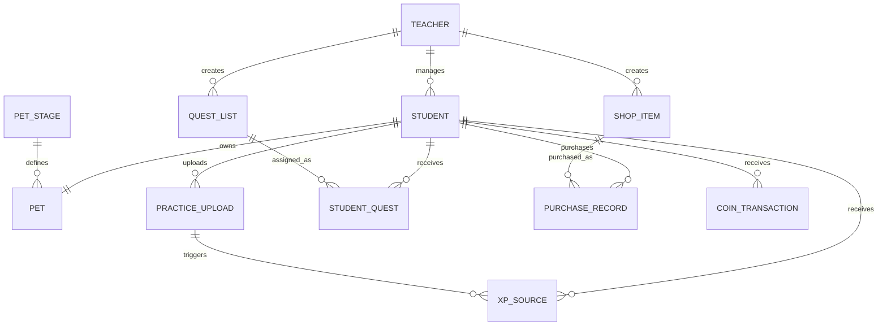

# Melody Quest｜Database Schema

## 1. 資料庫設定

```sql
CREATE DATABASE IF NOT EXISTS music_rpg_v2
  DEFAULT CHARACTER SET utf8mb4
  DEFAULT COLLATE utf8mb4_unicode_ci;
```

## 2. 資料表總覽

| 資料表 | 用途 |
|---|---|
| `teacher` | 老師帳號 |
| `student` | 學生帳號與總 XP、金幣 |
| `pet_stage` | 寵物進化階段 |
| `pet` | 學生目前寵物階段 |
| `practice_upload` | 練習錄音紀錄 |
| `quest_list` | 任務模板 |
| `student_quest` | 任務指派與進度 |
| `shop_item` | 商品 |
| `purchase_record` | 購買與兌換紀錄 |
| `xp_source` | XP 異動 |
| `coin_transaction` | 金幣異動 |

## 3. 關聯總覽



## 4. `teacher`

| 欄位 | 型態 | 限制 | 說明 |
|---|---|---|---|
| `teacher_id` | INT | PK、AUTO_INCREMENT | 老師 ID |
| `teacher_name` | VARCHAR(50) | NOT NULL | 老師姓名 |
| `email` | VARCHAR(100) | NOT NULL、UNIQUE | 登入帳號 |
| `password_hash` | VARCHAR(255) | NOT NULL | bcrypt 密碼雜湊 |
| `created_at` | TIMESTAMP | DEFAULT CURRENT_TIMESTAMP | 建立時間 |

## 5. `student`

| 欄位 | 型態 | 限制 | 說明 |
|---|---|---|---|
| `student_id` | INT | PK、AUTO_INCREMENT | 學生 ID |
| `teacher_id` | INT | FK、NOT NULL | 所屬老師 |
| `username` | VARCHAR(50) | NOT NULL、UNIQUE | 登入帳號 |
| `password_hash` | VARCHAR(255) | NOT NULL | 密碼雜湊 |
| `student_name` | VARCHAR(50) | NOT NULL | 學生姓名 |
| `password_changed` | BOOLEAN | DEFAULT FALSE | 是否改過初始密碼 |
| `total_xp` | INT UNSIGNED | DEFAULT 0 | 累積 XP |
| `total_coin` | INT UNSIGNED | DEFAULT 0 | 持有金幣 |
| `created_at` | TIMESTAMP | DEFAULT CURRENT_TIMESTAMP | 建立時間 |

## 6. `pet_stage`

| 欄位 | 型態 | 限制 | 說明 |
|---|---|---|---|
| `stage_id` | INT | PK、AUTO_INCREMENT | 階段 ID |
| `stage_name` | VARCHAR(50) | NOT NULL | 階段名稱 |
| `xp_threshold` | INT | NOT NULL | 進化門檻 |
| `image_url` | VARCHAR(255) | NULL | 圖片路徑 |
| `stage_order` | INT | NOT NULL | 階段順序 |

預設：

| 階段 | XP |
|---|---:|
| 蛋 | 0 |
| 幼體 | 100 |
| 成體 | 500 |
| 稀有型態 | 1500 |

## 7. `pet`

| 欄位 | 型態 | 限制 | 說明 |
|---|---|---|---|
| `pet_id` | INT | PK、AUTO_INCREMENT | 寵物 ID |
| `student_id` | INT | FK、NOT NULL、UNIQUE | 所屬學生 |
| `stage_id` | INT | FK、NOT NULL | 目前階段 |
| `updated_at` | TIMESTAMP | 自動更新 | 更新時間 |

## 8. `practice_upload`

| 欄位 | 型態 | 限制 | 說明 |
|---|---|---|---|
| `upload_id` | INT | PK、AUTO_INCREMENT | 上傳 ID |
| `student_id` | INT | FK、NOT NULL | 學生 |
| `audio_url` | VARCHAR(255) | NOT NULL | 音檔路徑 |
| `song_name` | VARCHAR(255) | NOT NULL | 曲目名稱 |
| `audio_duration` | INT UNSIGNED | NOT NULL | 錄音秒數 |
| `created_at` | TIMESTAMP | DEFAULT CURRENT_TIMESTAMP | 上傳時間 |

索引：

```sql
INDEX idx_student_created (student_id, created_at)
```

## 9. `quest_list`

| 欄位 | 型態 | 限制 | 說明 |
|---|---|---|---|
| `quest_id` | INT | PK、AUTO_INCREMENT | 任務 ID |
| `teacher_id` | INT | FK、NOT NULL | 建立老師 |
| `quest_name` | VARCHAR(100) | NOT NULL | 任務名稱 |
| `quest_type` | ENUM | NOT NULL | 任務類型 |
| `condition_type` | ENUM | NOT NULL | 任務條件 |
| `condition_value` | INT | NOT NULL | 條件數值 |
| `reward_xp` | INT | DEFAULT 0 | XP 獎勵 |
| `reward_coin` | INT | DEFAULT 0 | 金幣獎勵 |
| `is_repeatable` | BOOLEAN | DEFAULT TRUE | 是否可重複 |
| `is_active` | BOOLEAN | DEFAULT TRUE | 是否啟用 |
| `created_at` | TIMESTAMP | DEFAULT CURRENT_TIMESTAMP | 建立時間 |

`quest_type`：

```text
DAILY
WEEKLY
HIDDEN
```

`condition_type`：

```text
PRACTICE_COUNT
PRACTICE_DAYS
DISTINCT_SONGS
CONSECUTIVE_DAYS
TOTAL_UPLOADS
RETURN_AFTER_GAP
```

## 10. `student_quest`

| 欄位 | 型態 | 限制 | 說明 |
|---|---|---|---|
| `student_quest_id` | INT | PK、AUTO_INCREMENT | 紀錄 ID |
| `student_id` | INT | FK、NOT NULL | 被指派學生 |
| `quest_id` | INT | FK、NOT NULL | 任務 |
| `assigned_at` | DATETIME | DEFAULT CURRENT_TIMESTAMP | 指派時間 |
| `expires_at` | DATETIME | NULL | 到期時間 |
| `period_key` | VARCHAR(20) | NOT NULL | 任務期間識別 |
| `progress_value` | INT | DEFAULT 0 | 當前進度 |
| `completed` | BOOLEAN | DEFAULT FALSE | 是否完成 |
| `completed_at` | TIMESTAMP | NULL | 完成時間 |
| `created_at` | TIMESTAMP | DEFAULT CURRENT_TIMESTAMP | 建立時間 |

唯一限制：

```sql
UNIQUE KEY uk_student_quest_period (
    student_id,
    quest_id,
    period_key
)
```

狀態：

```text
completed = TRUE
→ 已完成

completed = FALSE 且 expires_at > NOW()
→ 進行中

completed = FALSE 且 expires_at <= NOW()
→ 已過期
```

## 11. `shop_item`

| 欄位 | 型態 | 限制 | 說明 |
|---|---|---|---|
| `item_id` | INT | PK、AUTO_INCREMENT | 商品 ID |
| `teacher_id` | INT | FK、NOT NULL | 建立老師 |
| `item_name` | VARCHAR(100) | NOT NULL | 商品名稱 |
| `item_type` | ENUM | NOT NULL | `VIRTUAL` / `PHYSICAL` |
| `price` | INT UNSIGNED | NOT NULL | 價格 |
| `stock` | INT UNSIGNED | NULL | 庫存 |
| `description` | VARCHAR(255) | NULL | 商品說明 |
| `image_url` | VARCHAR(255) | NULL | 圖片路徑 |
| `is_active` | BOOLEAN | DEFAULT TRUE | 是否上架 |
| `created_at` | TIMESTAMP | DEFAULT CURRENT_TIMESTAMP | 建立時間 |

## 12. `purchase_record`

| 欄位 | 型態 | 限制 | 說明 |
|---|---|---|---|
| `purchase_id` | INT | PK、AUTO_INCREMENT | 購買 ID |
| `student_id` | INT | FK、NOT NULL | 學生 |
| `item_id` | INT | FK、NOT NULL | 商品 |
| `price` | INT UNSIGNED | NOT NULL | 購買當下價格 |
| `status` | ENUM | DEFAULT `OWNED` | 狀態 |
| `created_at` | TIMESTAMP | DEFAULT CURRENT_TIMESTAMP | 購買時間 |

狀態：

```text
OWNED
PURCHASED
REDEEMED
```

## 13. `xp_source`

| 欄位 | 型態 | 限制 | 說明 |
|---|---|---|---|
| `xp_source_id` | INT | PK、AUTO_INCREMENT | 異動 ID |
| `student_id` | INT | FK、NOT NULL | 學生 |
| `upload_id` | INT | FK、NULL | 相關上傳 |
| `xp_amount` | INT | NOT NULL | XP 異動量 |
| `source_type` | ENUM | NOT NULL | 來源 |
| `created_at` | TIMESTAMP | DEFAULT CURRENT_TIMESTAMP | 建立時間 |

來源：

```text
PRACTICE_UPLOAD
QUEST_REWARD
HIDDEN_QUEST
TEACHER_ADJUST
```

## 14. `coin_transaction`

| 欄位 | 型態 | 限制 | 說明 |
|---|---|---|---|
| `coin_transaction_id` | INT | PK、AUTO_INCREMENT | 異動 ID |
| `student_id` | INT | FK、NOT NULL | 學生 |
| `source_type` | ENUM | NOT NULL | 來源 |
| `amount` | INT | NOT NULL | 正數增加、負數扣除 |
| `created_at` | TIMESTAMP | DEFAULT CURRENT_TIMESTAMP | 建立時間 |

來源：

```text
PRACTICE_UPLOAD
QUEST_REWARD
HIDDEN_QUEST
SHOP_PURCHASE
TEACHER_ADJUST
```

## 15. 維護規則

1. 真實 SQL 以 `sql/music_rpg_schema_v2.sql` 為準。
2. 修改資料表時同步更新本文件。
3. 不得自行更改欄位名稱。
4. 不得自行捏造 ORM 欄位。
5. 任務歷史紀錄不得直接刪除或重設。
