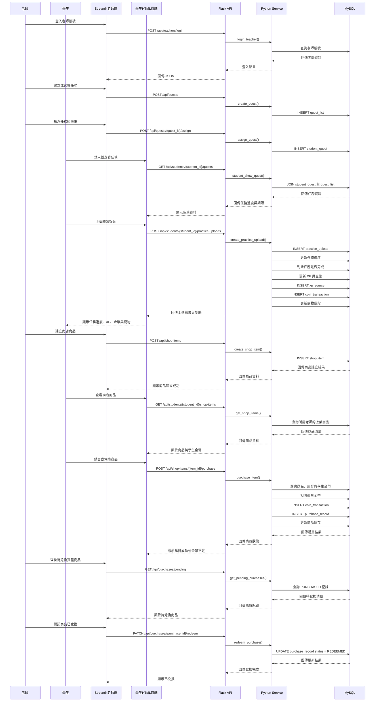

# 00_NoteAdventure 音樂練習 RPG 系統（最小可行性產品 Minimum Viable Product）

> 讓一對一音樂老師能更方便地管理學生練習狀況，並透過任務、XP、金幣與寵物成長等遊戲化機制，提高學生持續練習的意願。
> 

---

### 1. 專案概述與技術堆疊

- **專案名稱**：NoteAdventure 音樂練習 RPG 系統
- **英文名稱**：NoteAdventure Music Practice RPG System
- **核心目標**：
    - 協助一對一音樂老師建立學生帳號、管理練習任務與查看學生練習紀錄。
    - 學生透過上傳練習錄音完成任務，獲得 XP 與金幣，並推動寵物成長。
    - 驗證遊戲化獎勵是否能提升學生持續練習的意願。
- **目標使用者**：
    - **音樂老師**：建立學生、建立與指派任務、查看學生練習紀錄、建立獎品商店。
    - **學生**：查看任務、上傳練習錄音、取得 XP 與金幣、查看寵物成長。
- **技術堆疊**：
    - **前端介面（正式兩條線）**：
        - **老師端：Streamlit**（`streamlit_app.py`，僅老師管理）
            - 老師登入／註冊、學生、任務、上傳紀錄、商店／兌換。
            - 透過 HTTP 呼叫 Flask API，不直接操作資料庫。
        - **學生端：HTML／CSS／JS 一頁版**（正式入口 `/student/app`）
            - SPA 殼（BGM／橫放／全螢幕）+ iframe 載入功能內頁（登入、主頁、琴房、商店、任務、寵物、教室、設定）。
            - 由 Flask 提供 `templates/`、`static/web/`，以 `fetch` 呼叫同一套 Flask API。
        - 舊 Console／Streamlit 學生備援已移至 `archive/`（非正式入口）。開啟方式見 `docs/啟動說明.md`。
    - **後端**：Python、Flask
        - Flask 提供 RESTful API，並同時提供學生 HTML 頁面。
        - 負責登入驗證、學生管理、任務指派、錄音資料處理與獎勵計算。
        - 商業邏輯集中在 `services/`；路由在 `api/`。
    - **資料庫**：MySQL
        - 儲存老師、學生、任務、虛擬商品、錄音紀錄、XP、金幣與寵物狀態。
    - **資料庫連線**：PyMySQL
        - 負責 Python 與 MySQL 之間的資料查詢與異動。
    - **密碼安全**：bcrypt
        - 老師與學生密碼皆以雜湊形式儲存。
        - 資料庫不得保存明文密碼。
    - **套件管理**：
        - 使用 Python `venv` 建立虛擬環境。
        - 使用 `requirements.txt` 記錄專案所需套件。
    - **版本控制**：Git、GitHub
        - 每完成一個小功能建立一次 commit。
        - AI Agent 修改程式前，應先確認目前版本已 commit。
        - AI 修改後需先檢查差異並完成測試，再決定是否保留。
- **建議 Git 開發原則**：
    1. `main` 保留可正常執行的版本。
    2. 每完成一個獨立功能建立一次 commit。
    3. commit 訊息清楚說明本次變更。
    4. 較大型功能可建立 feature branch。
    5. AI Agent 不得一次修改大量無關功能。
- **建議功能分支**：
    - `feature/flask-api`
    - `feature/quest-assignment`
    - `feature/practice-upload`
    - `feature/reward-system`
    - `feature/streamlit-ui`

---

### 2. 資料庫綱要設計（Database Schema）

本專案使用 MySQL 關聯式資料庫。

每一列（Row）代表一筆獨立資料，例如一位老師、一位學生、一項任務或一次練習錄音；每一欄（Column）代表該筆資料的屬性。

MVP 使用的主要資料表如下：

| 資料表 | 每一列代表 | 主要用途 |
| --- | --- | --- |
| `teacher` | 一位老師帳號 | 儲存老師姓名、Email 與密碼雜湊 |
| `student` | 一位學生帳號 | 儲存學生資料、所屬老師、XP 與金幣 |
| `quest_list` | 一項任務模板 | 儲存任務條件、獎勵與建立老師 |
| `student_quest` | 一次任務指派紀錄 | 儲存學生任務進度、期限與完成狀態 |
| `practice_upload` | 一筆練習錄音紀錄 | 儲存曲目、錄音路徑、秒數與上傳時間 |
| `xp_source` | 一筆 XP 異動 | 記錄 XP 增加或調整來源 |
| `coin_transaction` | 一筆金幣異動 | 記錄金幣增加或扣除來源 |
| `pet_stage` | 一個寵物進化階段 | 定義各階段需要的 XP |
| `pet` | 一位學生的寵物狀態 | 儲存學生目前的寵物階段 |
| `shop_item` | 一項商品資訊 | 儲存老師建立的商品資訊 |
| `purchase_record` | 一筆購買與兌換紀錄 | 紀錄商品購買或兌換來源 |

#### 主要資料關聯

```
teacher
├── student
├── quest_list
└── shop_item

student
├── practice_upload
├── student_quest
├── xp_source
├── coin_transaction
├── pet
└── purchase_record

quest_list
└── student_quest

pet_stage
└── pet

shop_item
└── purchase_record
```

#### 任務指派資料

`student_quest` 每一列代表：

> 某位學生在特定期間被指派的一次任務。
> 

主要欄位：

| 欄位 | 型態 | 說明 |
| --- | --- | --- |
| `student_quest_id` | INT PK | 學生任務紀錄 ID |
| `student_id` | INT FK | 被指派的學生 |
| `quest_id` | INT FK | 被指派的任務 |
| `assigned_at` | DATETIME | 任務指派時間 |
| `expires_at` | DATETIME | 任務截止時間 |
| `period_key` | VARCHAR | 任務期間識別值 |
| `progress_value` | INT | 目前完成進度 |
| `completed` | BOOLEAN | 是否完成 |
| `completed_at` | TIMESTAMP | 任務完成時間 |

任務狀態判斷：

```
completed = TRUE
→ 已完成

completed = FALSE 且 expires_at > NOW()
→ 進行中

completed = FALSE 且 expires_at <= NOW()
→ 已過期
```

過期任務不得直接刪除或將進度歸零，應保留歷史紀錄。

---

### 3. 系統架構與資料流（System Architecture）

MVP 預計採用以下架構（老師與學生前端分開，共用同一套 Flask API）：

```
老師：Streamlit → Flask API → Service → PyMySQL → MySQL
學生：HTML/JS  → Flask API → Service → PyMySQL → MySQL
```



---

### 4. 核心功能與任務規則（Core Features）

#### 4.1 老師帳號與學生管理

老師可以：

- 使用 Email 註冊與登入。
- 建立學生帳號。
- 查看自己建立的學生。
- 重設學生密碼。
- 修改自己的密碼。

老師只能查看與管理：

```
teacher_id = 目前登入老師 ID
```

所屬的學生與任務。

#### 4.2 任務管理

老師可以：

- 查看任務
- 建立任務
- 修改任務
- 刪除任務
- 啟用或停用任務
- 指派任務給指定學生

任務資料庫使用英文代碼，例如：

```
WEEKLY
PRACTICE_COUNT
DISTINCT_SONGS
```

使用者介面則顯示中文：

```
每週任務
練習次數
不同曲目數
```

#### 4.3 任務期間

任務期限自指派時間起算，依任務類型不同，隱藏任務沒有時限。

| 任務類型 | 期限 | `period_key` |
| --- | --- | --- |
| 每日任務 `DAILY` | 一天 | 指派日期，例如 `2026-08-06` |
| 每週任務 `WEEKLY` | 七天 | ISO 週，例如 `2026-W32` |
| 隱藏任務 `HIDDEN` | 無期限，`expires_at` 為 NULL | `ONCE` |

例如：

```
每日任務
指派時間：2026-08-04 13:00
截止時間：2026-08-05 13:00

每週任務
指派時間：2026-08-04 13:00
截止時間：2026-08-11 13:00
```

計算方式：

```python
# DAILY
expires_at = assigned_at + timedelta(days=1)

# WEEKLY
expires_at = assigned_at + timedelta(days=7)

# HIDDEN
expires_at = None
```

`period_key` 只用於判斷同一期間是否重複指派，不需顯示給學生；學生介面顯示 `expires_at` 即可。

相同任務重新指派時，應新增新的 `student_quest` 紀錄，不得覆蓋上一期資料。

#### 4.4 任務進度

MVP 第一版只實作以下兩種條件：

#### 練習次數 `PRACTICE_COUNT`

計算任務期間內的錄音上傳筆數：

```
progress_value = 任務期間內的 practice_upload 數量
```

例如：

```
任務條件：上傳 3 次
目前進度：2 / 3
```

#### 不同曲目數 `DISTINCT_SONGS`

計算任務期間內不同的 `song_name` 數量：

```
progress_value = COUNT(DISTINCT song_name)
```

例如：

```
任務條件：練習 3 首不同曲目
目前進度：2 / 3
```

#### 4.5 任務完成與獎勵

當：

```
progress_value >= condition_value
```

系統應執行：

```
student_quest.completed = TRUE
student_quest.completed_at = NOW()

student.total_xp += reward_xp
student.total_coin += reward_coin

INSERT xp_source
INSERT coin_transaction
```

任務只有在：

```
completed = FALSE
```

時才可以發放獎勵，避免同一項任務重複取得 XP 與金幣。

任務完成與獎勵更新應使用同一個 transaction，若其中一步失敗，全部 rollback。

#### 4.6 寵物成長

寵物依照學生累積 XP 顯示階段：

| 寵物階段 | XP 門檻 |
| --- | --- |
| 蛋 | 0 |
| 幼體 | 100 |
| 成體 | 500 |
| 稀有型態 | 1500 |

MVP 只需要顯示：

- 目前 XP
- 目前寵物階段
- 下一階段
- 距離下一階段所需 XP

不要求複雜動畫或寵物裝飾功能。

---

### 5. MVP 驗收標準

MVP 完成時需符合：

1. 老師可註冊並登入。
2. 老師可建立至少一位學生。
3. 學生可登入。
4. 老師可建立並指派任務。
5. 學生可查看自己的任務與期限。
6. 學生可上傳至少一筆練習錄音。
7. 學生可在虛擬商店購買物品
8. 系統可更新任務進度。
9. 任務完成後可正確發放 XP 與金幣。
10. 同一任務不可重複發獎。
11. 寵物可依 XP 顯示正確階段。
12. 老師只能查看自己的學生與任務。
13. 密碼不得以明文儲存。
14. 查無資料時顯示提示，不直接報錯。

---

### 6. MVP 不包含的功能

以下功能不列入期中 MVP 第一版：

1. AI 演奏品質評分
2. 音高辨識
3. 節奏辨識
4. 即時音訊分析
5. 隱藏任務完整規則
6. 寵物裝飾系統
7. 排行榜
8. 好友或社群功能
9. LINE Bot
10. 推播通知
11. 雲端音檔儲存
12. 自動刪除錄音
13. 爬蟲與演出資訊輪播
14. Docker
15. 正式 Linux 部署
16. 手機 App
17. 完整動畫與美術設計
18. 多位老師共同管理同一位學生
19. 兩廳院廣告輪播

---

### 7. 第一版開發順序

#### 目前進度

| 階段 | 狀態 |
| --- | --- |
| 第一階段：帳號與任務功能 | 已完成（Console） |
| 第二階段：任務指派 | 已完成（Console） |
| 第三階段：Flask API | 已完成核心 API（登入、學生、任務建立／指派、練習上傳、商店、寵物、改密碼） |
| 第四階段：練習錄音上傳 | 已完成（Console + Streamlit／API） |
| 第五階段：任務進度與獎勵 | 已完成 |
| 第六階段：Streamlit 老師端整合 | 已完成核心頁面（透過 HTTP 串接 Flask，session cookie 維持登入） |
| 第六點五階段：學生 HTML 一頁版 | 已完成核心（殼層＋登入／主頁／商店／任務／寵物／琴房／教室／設定；背包尚為 placeholder） |
| 第七階段：測試與展示準備 | 進行中 |

商店與兌換已完成（老師 Streamlit＋學生 HTML 商店頁）。舊 Console／Streamlit 學生備援在 `archive/`。

任務進度計算目前只支援 `PRACTICE_COUNT` 與 `DISTINCT_SONGS`，其餘條件類型尚未實作。

正式前端：老師 Streamlit；學生一頁版 `/student/app`。開啟與部署見 `docs/啟動說明.md`。

網頁端尚未涵蓋：老師任務修改／刪除／啟停、商品修改／刪除／上下架、學生 HTML 背包實作、自動化測試。

#### 第一階段：完成既有帳號與任務功能

- 確認老師註冊與登入可正常運作
- 確認學生建立與登入流程
- 完成學生首次登入修改密碼
- 確認任務 CRUD 與啟用／停用功能

#### 第二階段：任務指派

- 顯示老師建立的任務
- 顯示老師所屬學生
- 選擇任務與學生
- 計算 `assigned_at`
- 計算 `expires_at`
- 建立 `period_key`
- 寫入 `student_quest`
- 防止相同期間重複指派

#### 第三階段：Flask API

- 建立 Flask 專案入口
- 建立 Application Factory
- 建立 Blueprint
- 建立登入 API
- 建立學生查詢 API
- 建立任務查詢與指派 API
- 統一 JSON 回傳格式
- 設定 HTTP status code

#### 第四階段：練習錄音上傳

- Streamlit 上傳音檔
- 輸入曲目名稱
- 取得或紀錄音檔秒數
- 儲存本機音檔
- 建立 `practice_upload`
- 老師查看學生上傳紀錄

#### 第五階段：任務進度與獎勵

- 計算練習次數
- 計算不同曲目數
- 更新 `progress_value`
- 判斷任務完成
- 發放 XP 與金幣
- 建立異動紀錄
- 防止重複發獎
- 更新寵物階段

#### 第六階段：Streamlit 老師端整合

- 老師登入頁
- 老師學生管理頁
- 老師任務管理頁
- 老師查看上傳紀錄／商品／兌換
- 串接 Flask API
- Streamlit 僅老師管理；學生只用 HTML 一頁版

#### 第六點五階段：學生 HTML 一頁版

- 正式入口殼層 `/student/app`（BGM、橫放、全螢幕）
- 登入、主頁地圖、商店、任務欄、寵物、琴房上傳、教室、設定（iframe 內頁）
- 尚未完成：背包頁實作（目前 placeholder）

#### 第七階段：測試與展示準備

- 建立測試老師與學生
- 建立測試任務
- 準備測試音檔
- 測試完整核心流程
- 修正錯誤訊息
- 建立 Git commit
- 準備期中 Demo

---

### 8. 期中展示流程

期中展示固定使用以下流程。  
老師操作在 **Streamlit**；切換學生時改開 **學生一頁版**（`http://127.0.0.1:5000/student/app`）。兩邊共用已啟動的 Flask API。

```
老師登入（Streamlit）
→ 查看學生列表
→ 建立一位測試學生
→ 建立或選擇一項任務
→ 建立一項虛擬商品
→ 指派任務給學生
→ 顯示任務期限
→ 切換至學生一頁版（/student/app）
→ 進入主頁地圖
→ 查看任務欄進度
→ 上傳練習音檔（琴房）
→ 系統更新任務進度
→ 任務完成
→ 顯示 XP 與金幣獎勵
→ 查看寵物階段
→ 於商店購買一項虛擬商品
→ 老師於 Streamlit 查看學生上傳紀錄
```

---

### 9. 成功指標

NoteAdventure MVP 不以功能數量判斷，而以下列條件作為成功標準：

1. 老師能在一分鐘內完成學生建立與任務指派。
2. 學生登入後能清楚看到自己的任務與期限。
3. 學生可以成功建立一筆練習錄音紀錄。
4. 系統可以根據錄音紀錄更新任務進度。
5. 任務達標後可以正確發放 XP 與金幣。
6. 寵物可以依照 XP 呈現正確成長階段。
7. 虛擬商店能正常運作。
8. 使用者能在短時間內理解「練習、任務、獎勵、寵物成長」之間的關係。
9. 開發者能說明老師 Streamlit、學生 HTML、Flask API、Service、PyMySQL 與 MySQL 之間的資料流。
10. 開發者能閱讀、測試並修改 AI Agent 產生的程式碼。
11. 系統能完整展示以下核心閉環：

```
任務
→ 練習
→ 進度
→ 完成
→ 獎勵
→ 成長
```